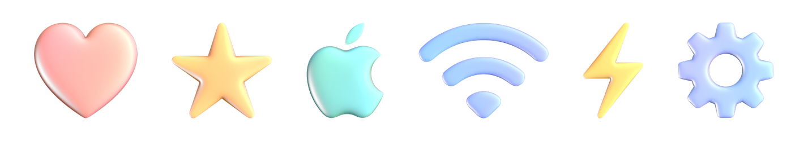
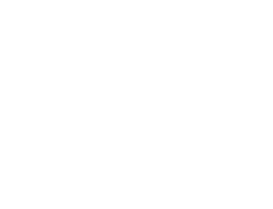

# GlassStroke


Render strokes and shapes as 3D glass, the way the macOS 27 / iOS 27 setup
screen draws its "hello": round glass tubes that bend the background behind
them, with rainbow fringes, a soft milky body, reflections and a light that
circles the glass. Handwriting can be written on, stroke by stroke.

A Swift package (macOS 14+, iOS 17+) with a command-line tool.



SF Symbols drawn on in glass, following SF Symbols' own Draw On paths:

 

## What you can render

- **Handwriting** in Apple's hello style: any text, written stroke by stroke.
  The pen strokes are read from the Macintosh Skeletal font on your own
  Mac, so nothing of Apple's is included.
- **Your own strokes**: centre lines with a pen radius, from a drawing app,
  Apple Pencil, a signature or a stroke-based logo.
- **Filled shapes**: SF Symbols, `CGPath`s or mask images, inflated into
  smooth glass. Thin parts become round tubes, wide parts smooth domes, and
  the outlines stay crisp.
- **Draw On**: SF Symbols (and custom symbols in your app's asset catalog)
  written on in glass, following the draw paths set up for them in the SF
  Symbols app, with Apple's timing. Shapes without draw paths can use an
  automatic order instead.

Output: still images, or the write-on animation as a transparent ProRes
`.mov`, an `.mp4`, a GIF or PNG frames.

## Command line

```
swift build -c release
.build/release/glassstroke "hello" -o hello.mov                  # over your desktop picture
.build/release/glassstroke "hello" -o hello.mov --transparent    # glass only, with alpha
.build/release/glassstroke "Thank you!" -o thanks.gif --backdrop photo.jpg
.build/release/glassstroke --symbol heart.fill -o heart.png --size 400
.build/release/glassstroke --symbol signature --draw -o signature.mov       # Draw On, in glass
```

Run `glassstroke --help` for every option: size, pen weight, timing curve,
light speed, refraction strength and so on.

## Library

```swift
import GlassStroke

let renderer = try GlassRenderer()
let backdrop = try loadImage(URL(fileURLWithPath: "wallpaper.jpg"))

// handwriting, written on
let (drawing, _) = try HelloHandwriting.drawing("hello")
let placement = Placement.fit(drawing, width: 1200, height: 600)
var movie = GlassAnimation(segments: drawing.segments(), backdrop: backdrop,
                           width: 1200, height: 600, placement: placement, duration: 2)
try movie.writeMovie(to: URL(fileURLWithPath: "hello.mov"), renderer: renderer)

// your own strokes
let line = Stroke(points: (0...100).map { i in
    StrokePoint(x: Float(i) * 10, y: 300 * sin(Float(i) / 16), radius: 40)
})
let image = try renderer.render(segments: Drawing(strokes: [line]).segments(), backdrop: backdrop,
                                width: 800, height: 400,
                                placement: .fit(Drawing(strokes: [line]), width: 800, height: 400))

// an SF Symbol (macOS)
if let heart = GlassShape.symbol("heart.fill") {
    let img = try renderer.render(shape: heart, backdrop: backdrop, width: 600, height: 600,
                                  placement: Placement(unitsPerPixel: 2.5, origin: SIMD2(-250, -300)))
}

// an SF Symbol or custom symbol written on with its Draw On paths
// (macOS 26+, main thread)
if let sig = GlassShape.symbolDrawOn("signature") {          // or symbolDrawOn("MyLogo", bundle: .main)
    var anim = GlassAnimation(segments: [], backdrop: backdrop, width: 800, height: 800,
                              placement: Placement(unitsPerPixel: 2, origin: SIMD2(-300, -300)),
                              duration: Double(sig.orderLength))   // Apple's own timing
    anim.shape = sig
    anim.timing = { $0 }                                     // already eased
    try anim.writeMovie(to: URL(fileURLWithPath: "signature.mov"), renderer: renderer)
}
```

`GlassStyle` sets the look: refraction strength, dispersion, backdrop blur,
how melted touching strokes are, the light and so on. The defaults are the
setup screen's values.

## How it works

Each stroke is a ball of the pen's radius swept along the centre line,
giving a round tube. Tubes melt into each other where they meet.

Filled shapes are inflated like a balloon: their height comes from a smooth
membrane stretched over the outline (a Poisson solution), square-rooted so a
stroke-like part gets a round cross-section, just like a pen tube. The
outline itself comes from an exact distance field, so it stays crisp.

For Draw On, SwiftUI's `.symbolEffect(.drawOn)` is played once off screen and
recorded. The moment the pen first reaches each point becomes the shape's
drawing order. Each video frame then inflates exactly the part drawn so far,
so every stroke ends in a round glass tip.

For each pixel, a ray is traced straight into the scene on the GPU:

1. It is marched to the glass surface.
2. It is refracted in, with a slightly different index for red, green and
   blue.
3. It is marched through the glass and refracted out the far side.
4. It picks up a blurred copy of the backdrop far below.
5. On top go a Fresnel reflection of the sharp backdrop, highlights from a
   circling key light and two fixed lights, and the setup screen's colour
   grading.

The parameters were measured from the setup screen's renderer.

## Limitations

- Handwriting needs macOS 27, which ships the Macintosh Skeletal font.
- Filled shapes are rasterised (1024 texels across by default), so very fine
  detail is softened.
- Draw On is recorded in real time, so it takes as long as the animation
  (about a second) and needs macOS 26. Each frame of a Draw On export
  inflates the shape anew, which takes about a third of a second.
- The glass takes its colour from the backdrop. Over a plain backdrop it
  looks nearly white.

## Disclaimer

The look reproduces the glass of Apple's setup screen. It was derived by
studying that renderer. This project is not affiliated with or endorsed by
Apple. "Apple", "macOS", "iOS" and "SF Symbols" are trademarks of Apple Inc.
